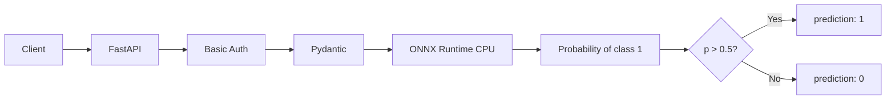

# HW8 — ML Model Serving
REST API для инференса
предоставленной ONNX-модели классификации диабета с использованием FastAPI.

## Возможности

- `GET /` — публичное приветствие.
- `GET /health` — публичная проверка готовности модели.
- `POST /predict` — прогноз по четырём числовым признакам, защищён HTTP Basic Auth.
- Валидация запросов и ответов (Pydantic), документация OpenAPI/Swagger.
- Логирование запросов и ответов: метод, шаблон маршрута, статус и время обработки.
- Медицинские признаки, результат предсказания и заголовки авторизации не логируются.
- Загрузка модели один раз при старте, автоматические тесты, Docker и CI.

## Быстрый запуск

Требуется Python 3.13 (рекомендуемая версия для воспроизводимого запуска).
Команды выполняются из корня репозитория.

### Windows PowerShell

```powershell
py -3.13 -m venv .venv
.\.venv\Scripts\python.exe -m pip install -r requirements-dev.txt
Copy-Item .env.example .env
.\.venv\Scripts\python.exe -m uvicorn app.main:app --no-access-log
```

### Linux / macOS

```bash
python3.13 -m venv .venv
source .venv/bin/activate
python -m pip install -r requirements-dev.txt
cp .env.example .env
python -m uvicorn app.main:app --no-access-log
```

Открыть в браузере:

- API: http://127.0.0.1:8000/
- Swagger UI: http://127.0.0.1:8000/docs
- ReDoc: http://127.0.0.1:8000/redoc

В Swagger нажать **Authorize** и ввести логин и пароль из `.env`.
Локальные демонстрационные значения: `demo_user` / `demo_pass`.

## Конфигурация

Настройки читаются из переменных окружения (они имеют приоритет) или `.env`.

| Переменная | Назначение | Значение по умолчанию |
|---|---|---|
| `BASIC_AUTH_USERNAME` | Логин | Обязательная |
| `BASIC_AUTH_PASSWORD` | Пароль | Обязательная |
| `MODEL_PATH` | Путь к модели | `models/diabetes_model.onnx` относительно проекта |
| `LOG_LEVEL` | Уровень логирования | `INFO` |


## API

| Метод | URL | Basic Auth | Ответ при успехе |
|---|---|---|---|
| GET | `/` | Нет | `{"message":"Welcome to the ML Model Serving API!"}` |
| GET | `/health` | Нет | `{"status":"ok"}` |
| POST | `/predict` | Да | `{"prediction":1}` или `{"prediction":0}` |

Тело запроса `POST /predict`:

```json
{
  "Pregnancies": 2,
  "Glucose": 140,
  "BMI": 35.5,
  "Age": 32
}
```

### Пример запроса: Windows PowerShell

```powershell
$body = @{ Pregnancies = 2; Glucose = 140; BMI = 35.5; Age = 32 } | ConvertTo-Json
$secure = ConvertTo-SecureString 'demo_pass' -AsPlainText -Force
$credential = [System.Management.Automation.PSCredential]::new('demo_user', $secure)
$pair = "$($credential.UserName):$($credential.GetNetworkCredential().Password)"
$token = [Convert]::ToBase64String([Text.Encoding]::ASCII.GetBytes($pair))
Invoke-RestMethod -Uri 'http://127.0.0.1:8000/predict' -Method Post `
    -Headers @{ Authorization = "Basic $token" } -ContentType 'application/json' -Body $body
```

### Пример запроса: Linux / macOS

```bash
curl -u demo_user:demo_pass \
  -H 'Content-Type: application/json' \
  -d '{"Pregnancies":2,"Glucose":140,"BMI":35.5,"Age":32}' \
  http://127.0.0.1:8000/predict
```

Ожидаемый ответ для примера задания:

```json
{"prediction": 1}
```

Коды ошибок:

| Код | Причина |
|---|---|
| 401 | Отсутствуют или неверны credentials (`WWW-Authenticate: Basic`) |
| 422 | Ошибка формата JSON или валидации входных признаков |
| 500 | Ошибка инференса (без раскрытия внутренних деталей) |
| 503 | Модель не готова (`/health`) |

## Как выполняется инференс



1. При старте FastAPI создаётся `onnxruntime.InferenceSession` с CPU provider.
2. Авторизация реализована через `HTTPBasic`, `Depends` и
   `secrets.compare_digest`. Выполняются обе проверки.
3. На каждый запрос создаётся отдельный NumPy-массив `float32` формы `(1, 4)`
   в порядке `[Pregnancies, Glucose, BMI, Age]`. 
4. Оригинальная модель имеет `output_label` и `output_probability`.
   Второй представляет список словарей вероятностей классов (ZipMap).
   Используется вероятность класса `1`, а не готовая метка.
5. `prediction = 1`, если `p > 0.5`, иначе `0` (включая ровно `0.5`).

Сервис не масштабирует и не нормализует входные признаки дополнительно:
передаёт их так, как предусмотрено исходным примером. Это учебная модель!!!
## Docker

Установите Docker Desktop или Docker Engine с Compose v2.
Создайте `.env` из `.env.example`, если это ещё не сделано.

```bash
docker compose up --build -d
docker compose ps
docker compose logs -f api
```

Запросы выполняются к тому же адресу `http://127.0.0.1:8000`.
Для остановки:

```bash
docker compose down
```

Контейнер работает от непривилегированного пользователя, содержит healthcheck
и публикует порт только на localhost через Compose.

## Структура проекта

```text
.
├── app/
│   ├── __init__.py
│   ├── auth.py          # HTTP Basic Auth
│   ├── config.py        # настройки
│   ├── inference.py     # адаптер ONNX Runtime
│   ├── main.py          # API и жизненный цикл
│   └── schemas.py       # контракты запросов и ответов
├── models/
│   └── diabetes_model.onnx
├── tests/               # unit, API и integration tests
├── .github/workflows/ci.yml
├── .env.example
├── .gitignore
├── .dockerignore
├── Dockerfile
├── docker-compose.yml
├── pyproject.toml
├── requirements.txt
├── requirements-dev.txt
└── README.md
```


## Качество кода и CI

Код документирован docstrings, публичные функции и методы имеют аннотации типов.
Длина строк для Black, Flake8 и Ruff согласована на 88 символах.

### Локальные проверки (Windows PowerShell)

```powershell
.\.venv\Scripts\python.exe -m black --check .
.\.venv\Scripts\python.exe -m flake8 app tests
.\.venv\Scripts\python.exe -m ruff check .
.\.venv\Scripts\python.exe -m pytest -v --cov=app --cov-report=term-missing
```

Black может автоматически отформатировать код командой
`.\.venv\Scripts\python.exe -m black .`. После форматирования повторите
проверки. Установка всех проверяющих инструментов выполняется через
`requirements-dev.txt`.

GitHub Actions запускается на `push` и `pull_request`:

- **lint** (Python 3.13): `black --check`, `flake8`, `ruff check`;
- **tests** (Python 3.12 и 3.13): pytest с настоящей ONNX-моделью и
  минимальным покрытием `90%`.

Все команды CI должны завершиться успешно до сдачи. CI использует
демонстрационные учётные данные **только внутри тестов**. Секретный `.env`
в репозиторий добавлять нельзя: для локального запуска скопируйте `.env.example`.
